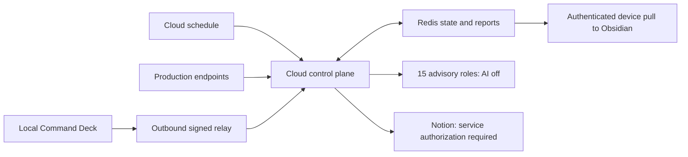

# Command Deck Cloud Agents

A cloud control plane for the existing Command Deck portfolio: **15 specialist roles**, laptop-independent production monitoring, durable state, and Notion/Obsidian report delivery.

**Paid AI is disabled. Production mutations are unavailable.** Fifteen role definitions do not mean fifteen continuously running model processes. Probes, incident handling and report delivery invoke no model. The runtime uses eve 0.80.1 (preview), built through Codex.

## Team

| Role | Responsibility |
|---|---|
| Operations Orchestrator | Priorities, ownership and bounded delegation |
| Portfolio Steward | Inventory and lifecycle |
| Reliability Monitor | Availability, latency and freshness |
| Incident Commander | Triage and response plans |
| Security Reviewer | Security evidence and proposed fixes |
| Dependency Steward | Advisory and upgrade proposals |
| Frontend Maintainer | UI and accessibility proposals |
| Backend Maintainer | API and service proposals |
| Data and Identity Steward | Migrations, identities and recovery |
| Verification Engineer | Test plans and evidence checks |
| Release Reviewer | Review readiness, without deployment |
| Cost and Capacity Analyst | Limits and spending |
| Knowledge Graph Curator | Context, decisions and provenance |
| Notion and Obsidian Reporter | Sanitized reports and delivery |
| Command Deck Integration Steward | Contracts and snapshot freshness |

## Architecture

The existing hosted Command Deck stays a read-only mirror. Its local API is never exposed. Public production probes run in the cloud; local systems stay unobserved without a fresh signed relay snapshot. Relay data cannot override cloud production checks.

## Verify

Requires Node **24.x**. Run `npm ci`, `npm run typecheck`, `npm test`, then `npm run build`. For a controlled development server use `npm exec -- eve dev --no-ui`. Monitoring fails closed without durable storage. Do not use the model REPL to test monitoring.

See [Deployment](docs/DEPLOYMENT.md), [Operations](docs/OPERATIONS.md), [Command Deck contract](docs/COMMAND_DECK.md) and [Security](SECURITY.md).

| Route | Authentication | Effect |
|---|---|---|
| `GET /ops/health` | Public | Liveness only |
| `GET /ops/status` | Owner bearer | Project, agent, task and delivery status |
| `POST /ops/monitor` | Scheduler or owner bearer | Bounded probes and one pending Notion delivery |
| `GET /ops/reports?after=N` | Owner bearer | Paginated immutable reports |
| `POST /ops/deck-snapshot` | Signed relay | Fresh non-production observations |
| `POST /ops/proposals` | Owner bearer | Review-only proposal; no source changes |
| `/eve/v1/session…` | Owner bearer and paid-AI gate | Durable advisory sessions; disabled by default |

## Scope

Eleven registered projects include three direct production endpoints. Two consecutive failed observations open one incident. Recovery remains open for review. These checks do not establish authenticated functionality, database correctness or a complete security assessment.

Vercel daily cron is a fallback. The optional GitHub workflow requests checks every 15 minutes; schedules can be delayed or disabled and provide no uptime SLA. Stale monitoring is visible in status.

State has explicit limits of 500 tasks and 1,000 reports; it refuses writes rather than discarding evidence. Private reports, vault content, credentials and local paths remain outside Git. Notion service authorization, private-source access, device relay and device pull schedules require independent configuration.

The default model is the official eve scaffold default. A separately managed Codex harness is a later extension requiring its own credentials, isolated environment and approved budget. No local subscription credentials are uploaded.
